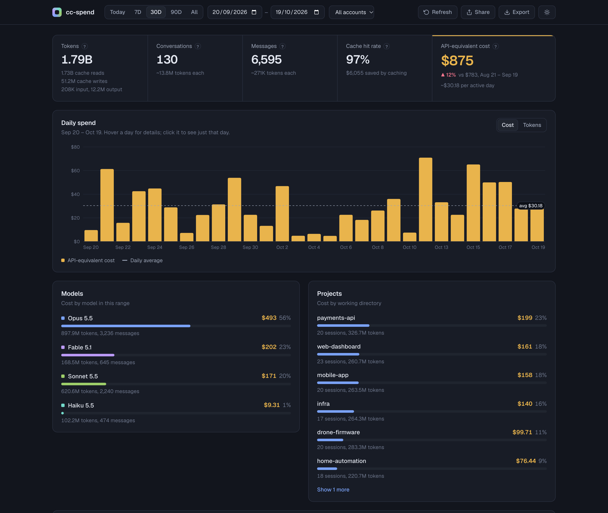
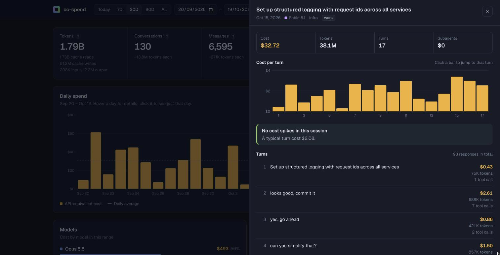
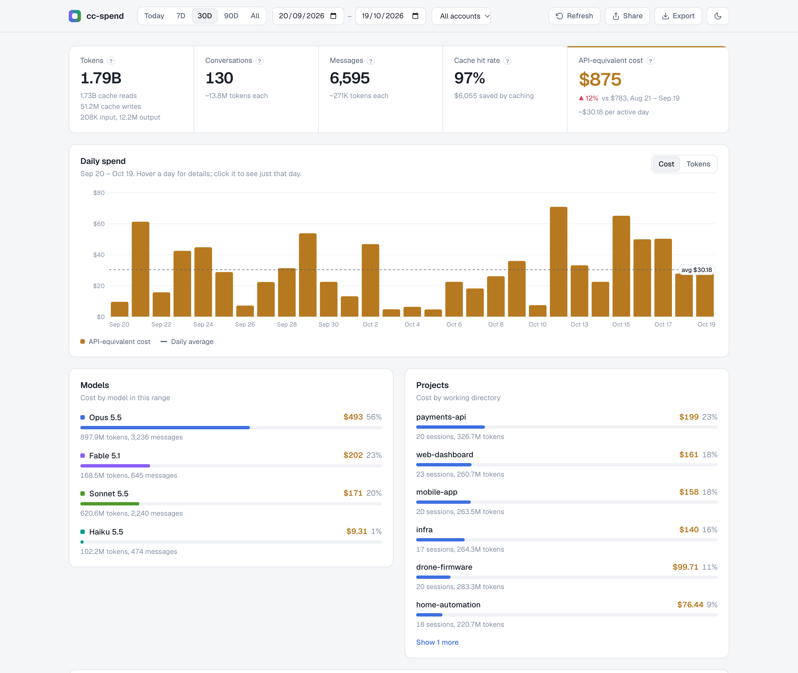

# cc-spend

See what your Claude Code usage actually costs. One command, runs locally.

```
npx @shravanrevanna/cc-spend
```

Opens a dashboard in your browser with your tokens, API-equivalent cost and cache savings per day, model, project, session and turn.



<sub>Screenshots use generated demo data (`npm run demo`).</sub>

## What you get

- **Real cost, priced correctly.** Current Anthropic list prices for Opus, Sonnet, Haiku and Fable (5.x and older), with 5-minute and 1-hour cache writes each priced at their own rate. Models without a known price are flagged, not guessed.
- **Every account.** Reads `~/.claude`, `$CLAUDE_CONFIG_DIR` and any `~/.claude-*` folder, so work and personal configs show side by side or one at a time.
- **Any date range.** Presets (today, 7, 30, 90 days, all) or pick dates. Cost shows the change against the previous period of the same length.
- **Drill down.** Hover the daily chart for a breakdown and click a day to zoom in. Open any session to see cost per turn and where it spiked.
- **Subagents included.** Subagent transcripts are counted and attributed to the turn that started them.
- **Export.** Download sessions, daily totals, models, projects or top prompts as CSV, or the full report as JSON.
- **Dark and light themes.** Follows your system setting; the toggle remembers your choice.
- **Private.** Binds to `127.0.0.1` only and never sends your data anywhere.



<details>
<summary>Light theme</summary>



</details>

## Options

Install it once to get a short `cc-spend` command:

```
npm install -g @shravanrevanna/cc-spend
```

```
cc-spend --days 30                       # open on the last 30 days
cc-spend --from 2026-10-01 --to 2026-10-15
cc-spend --account personal              # open filtered to one account
cc-spend --dir work=~/.claude --dir personal=~/.claude-personal
cc-spend --port 8080                     # default: 3456
cc-spend --no-open                       # don't open the browser
```

`--dir` is repeatable and takes an optional `label=` prefix. Without it, cc-spend finds your config folders on its own.
The date range and account can also be changed in the dashboard, and the URL keeps the current view.

## How cost is counted

Claude Code writes each response as several JSONL rows and copies rows into resumed sessions, so cc-spend dedupes usage by `requestId` + `message.id` before adding anything up. Costs are what the same tokens would cost on the Anthropic API at list price. Subscription plans bill differently, so treat the number as the value you got out of your plan, not your invoice.

## Development

```
npm install
npm test                 # parser tests
npm run demo             # write demo transcripts and print the command to view them
npm start
```

## Credits

Inspired by [claude-spend](https://github.com/writetoaniketparihar-collab/claude-spend) by Aniket Parihar. MIT licensed.
